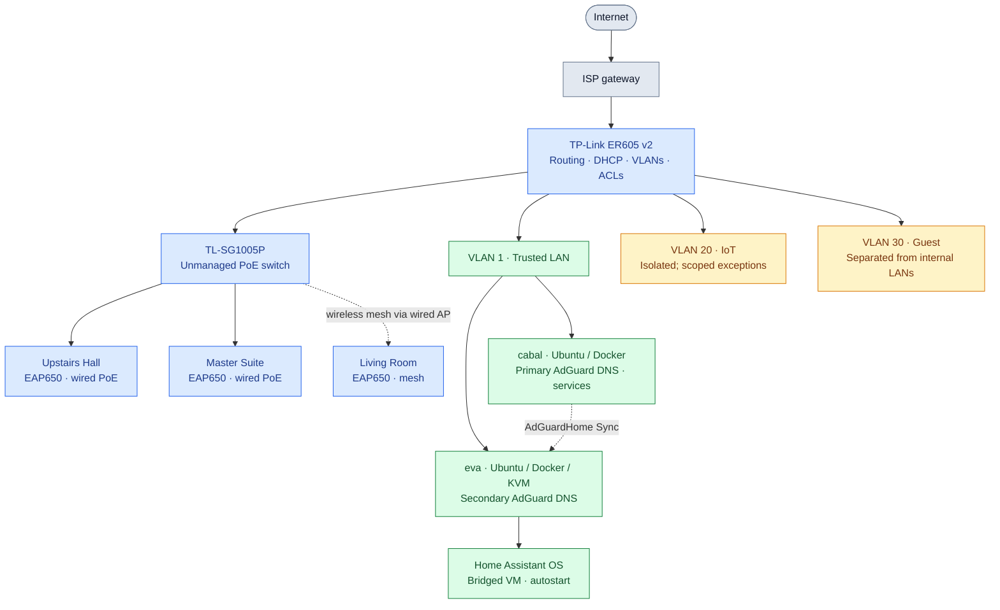

# Building a Home Network Engineering Lab

**A hands-on networking and self-hosting project built with secondhand mini PCs, TP-Link Omada gear, Linux, and plenty of troubleshooting.**

I moved into IT after working in healthcare, and building this homelab has been my way of learning what happens *underneath* the applications people use every day. What began as a few self-hosted services turned into an ongoing project in network design, segmentation, DNS reliability, Wi-Fi, virtualization, and practical security.

This repository is a **public, sanitized technical writeup** of the network I've built and tested—not a claim that the lab is an enterprise deployment or that every planned feature is finished.

> **Snapshot:** November 9, 2026 · **Status:** Active, working homelab · **Focus:** Networking, reliability, and hands-on learning

## At a glance

| Area | What is running |
| --- | --- |
| Network edge | TP-Link ER605 v2 router with DHCP, VLANs, and access-control rules |
| Network segments | Trusted LAN (**VLAN 1**), IoT (**VLAN 20**), Guest (**VLAN 30**) |
| Wireless | **3 × Omada EAP650** APs: two wired/PoE, one wireless mesh |
| Compute | **2 × Lenovo ThinkCentre M910q Tiny** systems running Ubuntu Server |
| DNS | **2 × AdGuard Home** resolvers with config sync and tested client failover |
| Virtualization | Home Assistant OS VM on KVM/libvirt, bridged to the Trusted LAN |
| Operations | Docker, Portainer, Uptime Kuma, Homepage, Tailscale, rack touchscreen |
| Storage / media | Four-bay DAS with **4 × 2 TB disks in RAID10**, SMB, Jellyfin, Immich |

## Network topology

*Logical overview, not a port-by-port wiring map. The Living Room AP connects over an Omada wireless mesh uplink to a wired AP; the diagram does not imply a physical connection to the PoE switch. Individual IP addresses, credentials, and WAN details are deliberately omitted.*

The editable diagram also lives in [`diagrams/network-topology.mmd`](diagrams/network-topology.mmd). A [standalone SVG export](diagrams/network-topology.svg) is included for sharing or viewing outside GitHub.

## Network design and segmentation

The biggest change from my original setup was treating the home network as several different trust zones instead of one flat LAN.

| Network | Intended devices | What I configured |
| --- | --- | --- |
| **VLAN 1 — Trusted** | Administration, Ubuntu hosts, Home Assistant | Primary internal services and management network |
| **VLAN 20 — IoT** | Smart-home devices and casting endpoints | Separate SSID (**Wu-Tang LAN**), inter-VLAN ACLs, internal DNS enforcement, narrowly scoped service exceptions |
| **VLAN 30 — Guest** | Visitors | Separate guest network with Internet access and isolation from the internal networks |

**Details that mattered in practice:**

- Created and tested router ACLs rather than relying only on different SSID names.
- Enforced conventional **TCP/UDP port 53 DNS** from IoT clients to my internal AdGuard servers; tested that direct queries to public DNS resolvers were blocked.
- Enabled cross-VLAN discovery where needed, including an **mDNS helper** for devices such as Google Cast.
- Added a targeted **IoT → Home Assistant TCP 8123** exception to make a specific smart-home workflow work without opening broad IoT access to the Trusted LAN.
- Kept the ISP gateway, router, switch, APs, and server roles separate in my documentation to make troubleshooting easier.

> **Scope note:** Blocking ordinary external DNS queries is **not** the same as fully preventing encrypted DNS (DoH/DoT/QUIC). That additional enforcement was still a work item at this snapshot.

## Reliable DNS, not just a second DNS container

My DNS setup is one of the pieces I'm proudest of because I didn't stop at getting two servers to answer queries.

| Component | Role |
| --- | --- |
| **`cabal`** | Primary AdGuard Home DNS resolver |
| **`eva`** | Secondary AdGuard Home DNS resolver |
| **AdGuardHome Sync** | Keeps resolver configuration aligned (configured for periodic sync) |
| **ER605 DHCP** | Advertises both internal resolvers to clients across the relevant networks |
| **Local DNS rewrites** | Resolve internal services, including `homeassistant.home.arpa` |

**How I validated it:** I deliberately stopped the primary DNS service and also tested a full `cabal` reboot. Clients continued resolving through the secondary resolver. I also verified the IoT DNS policy against public DNS endpoints, instead of assuming the ACLs worked because they looked correct in the router UI.

**What I learned:** Redundancy is an end-to-end property. A second server only helps if clients know about it, routing and firewall rules allow access, configuration stays consistent, and failure has actually been tested. This is resilient *client DNS failover*, not a clustered high-availability platform.

## Wireless coverage and physical infrastructure

I replaced my older Deco S4 mesh system with an Omada-managed three-access-point setup:

| AP | Backhaul | Placement |
| --- | --- | --- |
| **Upstairs Hall** · EAP650 | Wired Ethernet + PoE | Ceiling mounted |
| **Master Suite** · EAP650 | Wired Ethernet + PoE | Ceiling mounted |
| **Living Room** · EAP650 | Wireless mesh | Living room |

The two wired APs receive power from a **TP-Link TL-SG1005P** PoE switch. All three are adopted into an **Omada Controller running in Docker**. I worked through network migration, AP placement, VLAN-carrying Wi-Fi configuration, channel selection, and interference troubleshooting. For example, I set an upper non-DFS 5 GHz channel (149, 80 MHz) on the root AP and investigated co-channel interference seen during 2.4 GHz scans.

This gave me a practical lesson in the difference between **coverage, interference, backhaul, and roaming**: a strong signal doesn't automatically mean a good connection.

## Linux, virtualization, and the services on top

The network supports two Ubuntu Server-based Lenovo ThinkCentre M910q Tiny systems:

| System | Confirmed responsibilities |
| --- | --- |
| **`cabal`** | Main Docker host; primary AdGuard Home; Omada Controller; Nginx Proxy Manager; Homepage; Uptime Kuma; Jellyfin; Immich; Vaultwarden; Portainer; Tailscale |
| **`eva`** | Secondary AdGuard Home; Docker/Portainer; Tailscale; KVM/libvirt host for Home Assistant OS |

- **Home Assistant:** Runs as a bridged HAOS VM on `eva`, with VM autostart configured. Local DNS provides a memorable `.home.arpa` address.
- **Real cross-VLAN automation:** A Nest doorbell press is detected in Home Assistant, which triggers a Google Cast text-to-speech announcement on a Nest Audio speaker. Getting the discovery and media retrieval paths working required targeted troubleshooting, mDNS, and the narrow TCP 8123 rule.
- **Remote administration:** Tailscale enables authenticated remote reachability; remote SSH to `eva` was tested.
- **Monitoring:** Uptime Kuma and Homepage give me visibility into services. A **7.84-inch, 1280 × 400** rack-mounted display attached to `cabal` serves as a monitoring dashboard.
- **Storage:** A four-bay MAIWO DAS has **4 × 2 TB HDDs in RAID10**, providing roughly **4 TB decimal usable** storage, with SMB shares for media. RAID10 adds disk fault tolerance; **it is not a substitute for backups**.
- **Media hardware:** I physically upgraded `cabal` to an **Intel Core i5-7600T / Intel HD Graphics 630** to improve the hardware capabilities available to Jellyfin, particularly around HEVC Main10. This is a completed hardware change, not a claim that every transcoding path has been benchmarked.

## Selected technical milestones

These are things I actually deployed or validated, not just technologies I've read about.

| Challenge | What I did | Result / takeaway |
| --- | --- | --- |
| DNS service as a single point of failure | Added a second AdGuard resolver, config synchronization, DHCP settings, and ACLs; simulated failure | **Client DNS failover tested successfully** |
| Guest devices on the same network as personal equipment | Created VLAN 30 and its wireless/client policies | **Guest access separated from Trusted and IoT** |
| IoT devices using hard-coded public DNS | Restricted ordinary outbound DNS on VLAN 20 to internal resolvers | **Direct public port-53 DNS tests blocked** |
| Cast devices and Home Assistant separated by VLANs | Worked through mDNS discovery and narrow application traffic exceptions | **Doorbell-to-Cast TTS automation working** |
| Limited control over Wi-Fi coverage | Migrated from consumer mesh to three Omada EAP650s with two wired PoE uplinks | **Controller-managed wireless network operating** |
| Service visibility | Added dashboards and uptime monitoring, including a physical rack display | **More observable day-to-day operations** |

## Lessons learned

1. **A network diagram is the easy part; traffic flows are the hard part.** VLANs, mDNS, firewall policy, and application ports all have to work together.
2. **Always test the failure mode.** A second DNS server wasn't enough until I shut down the first one and watched clients recover.
3. **The smallest firewall exception is usually the best one.** Getting casting to work didn't require giving the entire IoT network access to everything.
4. **Wi-Fi troubleshooting needs evidence.** Access-point placement, wired versus wireless backhaul, channel width, and interference often matter more than a signal-strength icon.
5. **Self-hosting teaches the whole stack.** A service that appears broken might actually be a DNS, routing, permissions, container, virtualization, or device-discovery problem.
6. **Document working states.** A snapshot of VLANs, ACL decisions, host roles, and successful tests makes later changes much safer.

## What I'm working toward

I'm still early in my *formal* networking education. I'm studying for my first **CompTIA A+** exam (scheduled for November 2026), and I want to follow that with **Network+** and **CCNA** while continuing to learn through real lab work. Longer term, I'm interested in moving from general IT support toward network administration and engineering.

**Next lab goals — planned, not presented as completed:**

- Introduce a **managed PoE switch** for deeper switching, VLAN, and port-level troubleshooting practice.
- Add a dedicated **firewall/router lab appliance** for more advanced routing and policy experiments.
- Explore traffic captures and stronger controls for encrypted DNS egress from untrusted devices.
- Keep expanding monitoring, documentation, and repeatable network validation checks.

## A note on privacy and reproducibility

This is a public portfolio of methods, hardware, decisions, and observed results. It intentionally excludes my public IP, internal host addresses, Tailscale addresses, credentials, API tokens, real DHCP leases, and exports of production firewall rules. Any future examples or screenshots will be sanitized before publication.

---

**Why I built this:** I learn best by putting things together, breaking them, figuring out why they broke, and making them better. The goal isn't to own the most gear—it's to understand the network well enough to explain, operate, and improve it.
